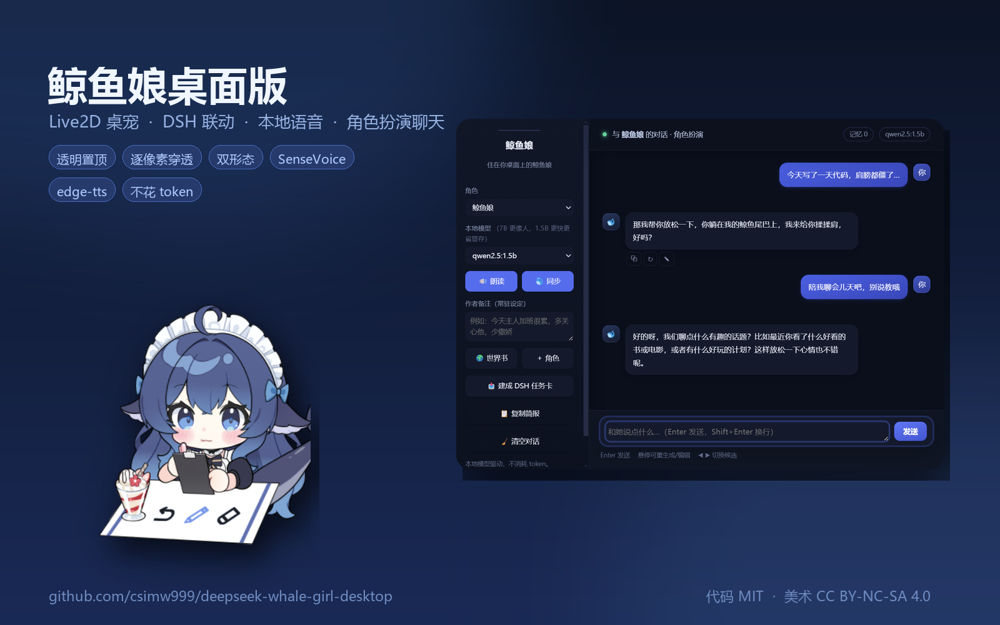
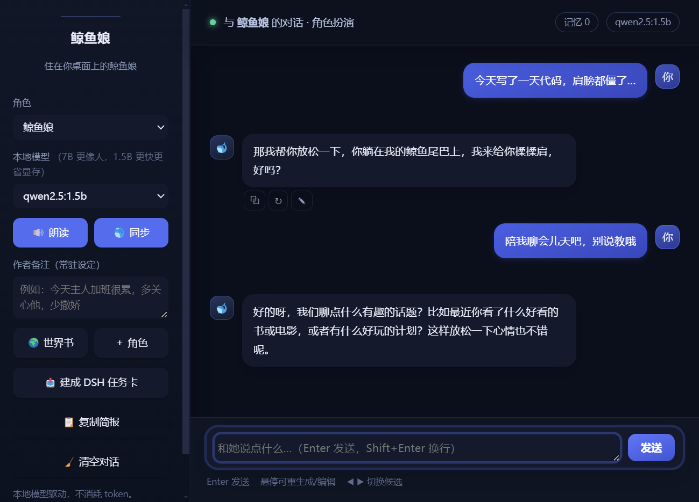
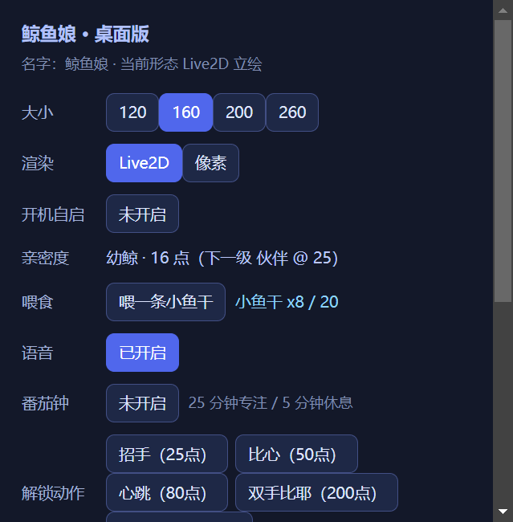

# 鲸鱼娘桌面版 · Whale Girl Desktop


把 dsh-pet 的 Live2D 鲸鱼娘搬到 **Windows 桌面**上：透明置顶、可拖动、会跟着 DeepSeek Harness 干活而做出反应，还能和她聊天、听她说话。



## 界面

| 桌面常驻 | 角色扮演聊天 | 设置 |
| --- | --- | --- |
|  |  |  |

## 它做什么

| 能力 | 说明 |
| --- | --- |
| 桌面常驻 | 透明无边框窗口 + alpha 命中测试（点空白处会穿透到下层窗口） |
| 双形态 | Live2D（12 套动作 / 18 个表情）与像素形态可随时切换 |
| DSH 联动 | 监听 DSH 会话事件：思考 / 工具 / 审查时换表情并冒泡 |
| 本地语音 | SenseVoice 语音识别 + edge-tts 合成，支持按住说话与常听模式 |
| 角色扮演聊天 | 独立聊天窗，带历史、记忆、世界书、作者注、重答 / 编辑 / 多方案 |
| 记忆与导出 | 长期记忆可查看 / 删除 / 手动补；对话可导出 Markdown 或 JSON，也能导入回来 |
| 任务投递 | 把聊天内容写成 DSH 任务卡（写 `ledger-v2.json`，无需鉴权） |
| 小工具 | 余额面板、番茄钟、成就、亲密度 / 投喂 |

默认名字是「鲸鱼娘」，可以在设置或角色卡里改成你喜欢的名字。

## 快速开始

### 第一步：下载程序

去 [**Releases**](https://github.com/csimw999/deepseek-whale-girl-desktop/releases/latest) 下载：

| 文件 | 用途 | 体积 |
| --- | --- | --- |
| `whale-girl-0.3.0-win32-x64.zip` | **程序本体**（内置 Electron，不用装 Node） | ~134 MB |
| `whale-girl-models-1.5b.zip` | **模型一键包**（聊天 + 语音识别，装完即用） | ~1.07 GB |

解压程序本体，然后双击 `启动鲸鱼娘.bat`，她就出场了。

> ⚠️ **解压路径尽量短、别带中文**（推荐 `D:\whale-girl`）。
> Chromium 在部分机器上遇到超长或中文路径会直接闪退（本机实测崩 `0x80000003`）。

### 第二步：装模型（想聊天才需要）

模型包下载后，解压到**鲸鱼娘目录里**（和 `启动鲸鱼娘.bat` 同级，覆盖即可），然后双击里面的 **`安装模型.bat`**。

它会自动完成：

1. 把 SenseVoice 语音识别模型拷进程序目录
2. 把 sherpa-onnx 推理程序拷进程序目录
3. 把 `qwen2.5:1.5b` 的模型文件导入 ollama（**不需要联网重新下载**）
4. 检查 ollama，没装会提示你用 `winget install Ollama.Ollama` 或去官网装

装完就能聊天了。想要更像人的回复，再手动拉一次 7B：

```powershell
ollama pull qwen2.5:7b
```

> 7B 有 4.7 GB，超过 GitHub 单个附件 2 GiB 限制，所以不打包；用下面的「让她自己下载」或手动 `ollama pull` 都行。

### 或者：让她自己下载（最省事）

启动后如果检测到**没有聊天模型**，会自动弹一个框：

| 选项 | 说明 |
| --- | --- |
| 下载 1.5B（1 GB，快） | 日常聊够用 |
| 下载 7B（4.7 GB，更像人） | 说话更像个人 |
| 稍后再说 | 她照样出场，只是不能聊天 |

下载过程中她会冒泡报进度（每 10% 一次），走的是 **ollama 官方源**，支持断点续传。

以后想换模型：按 `Ctrl+Shift+S` 打开设置 →「下载聊天模型…」。

> **为什么 7B 不打包？** GitHub 规定每个发布附件必须小于 **2 GiB**（[官方文档](https://docs.github.com/en/repositories/releasing-projects-on-github/about-releases#storage-and-bandwidth-quotas)），而 7B 模型 4.7 GB 放不下。
> 这种「大模型不进安装包、首次运行再下载」的做法，LM Studio、ComfyUI、Ollama 自己都是这么干的。

### 不想下载模型包？也可以手动准备

| 组件 | 用途 | 获取方式 |
| --- | --- | --- |
| ollama | 本地模型运行时 | [ollama.com/download](https://ollama.com/download) |
| `qwen2.5:1.5b` | 聊天（1 GB，推荐先用这个） | `ollama pull qwen2.5:1.5b` |
| `qwen2.5:7b` | 聊天（4.7 GB，更像人） | `ollama pull qwen2.5:7b` |
| SenseVoice | 语音识别 | [sherpa-onnx releases](https://github.com/k2-fsa/sherpa-onnx/releases) 里的 `sherpa-onnx-sense-voice-zh-en-ja-ko-yue-2024-07-17`，放 `voice-models/` |
| sherpa-onnx CLI | 语音识别推理 | 同上 releases 的 `sherpa-onnx-v1.13.8-win-x64-shared-MD-Release`，放 `tools/sherpa/` |

语音合成走 `edge-tts`（联网调微软接口，免费），不需要下载任何模型。

### 从源码跑（开发者）

```powershell
git clone https://github.com/csimw999/deepseek-whale-girl-desktop.git
cd deepseek-whale-girl-desktop
npm install
npm start
```

> 直接命令行启动必须带参数，否则窗口不会出现：
> `.\node_modules\electron\dist\electron.exe . --no-sandbox --user-data-dir=.\data\userdata`

### 热键

| 热键 | 功能 |
| --- | --- |
| `Ctrl+Shift+C` | 打开 / 关闭聊天窗 |
| `Ctrl+Alt+V` | 按住说话 |
| `Ctrl+Shift+L` | 常听模式（VAD 自动断句） |
| `Ctrl+Alt+B` | 余额面板 |
| `Ctrl+Shift+S` | 设置 |
| `Ctrl+Shift+M` | 切换形态（Live2D / 像素） |
| `Ctrl+Alt+H` | 显示 / 隐藏 |
| `Ctrl+Alt+Q` | 退出 |

## 便携模式（U 盘 / 换机带走记录）

默认数据在 `%APPDATA%\WhaleGirlDesktop`，升级时覆盖程序目录不会丢记录。

想让**整个文件夹自带记录**：把压缩包里的 `portable.txt.example` 改名为 `portable.txt`，放在 `鲸鱼娘.exe` 同级。

```
whale-girl-0.3.0-win32-x64\
  ├ 鲸鱼娘.exe
  ├ portable.txt        ← 建了就启用便携模式
  └ data\               ← 聊天记录 / 记忆 / 头像 / 设置 / 日志全在这里
```

整个文件夹拷到 U 盘或另一台电脑，记录会跟着走；删掉 `portable.txt` 就回到 APPDATA 模式。

## 更新机制

打包版启动 12 秒后查一次 GitHub Releases（`api.github.com`，无鉴权）：

- 有新版本 → 她冒泡提示 + 弹窗，点「打开发布页」直接去下载
- 覆盖解压新程序即可，**聊天记录 / 设置 / 头像都在 APPDATA（或便携目录），不会丢**

## 多显示器

浮层覆盖**所有显示器工作区的并集**，她可以被拖到副屏；插拔显示器或改分辨率时自动重算范围。

位置按「距右下角多少像素」记录在 `host-state.json`，换分辨率会尽量贴回原来的角。

## 目录结构

```
main.js              Electron 主进程：窗口/托盘/热键/语音/聊天/DSH 联动
live2d/              Live2D 页面（pet.js 为上游原版 + 2 处补丁）
  pet.js             上游构建产物，仅加了 __DSHPetHit 与 setFace
  model/             模型（moc3 + 44 个表情 + 8 套动作）
app/                 像素形态（插件产物 + 假宿主 host.js）
ui/                  设置窗 / 聊天窗 / 余额面板
voice/               语音采集窗（按住说话 / VAD）
tools/               DSH 事件监听、语音脚本、打包脚本
assets/              图标、音效
docs/                截图、设计文档、开发日志
```

## 常见问题

**双击没反应 / 窗口闪一下就没有？**
解压路径含中文或太长。换到 `D:\whale-girl` 这种短路径重试（Chromium 在这台机器上会崩 `0x80000003`）。

**她出场了但聊天没反应？**
三种可能：① 没装 ollama；② 没装模型（右键托盘附近的热键 `Ctrl+Shift+S` →「下载聊天模型…」）；③ ollama 没在运行（任务栏找它的图标，或执行一次 `ollama list` 唤醒）。

**说话没声音 / 语音没反应？**
合成走 edge-tts，需要联网；识别需要在 `voice-models/` 放 SenseVoice 模型（模型包里有）。

**下载模型卡住？**
ollama 支持断点续传，直接重试即可；也可以在设置里再点一次「下载聊天模型…」。

**想换回默认名字？**
设置在 `%APPDATA%\WhaleGirlDesktop\data\characters\whale.json`（便携模式在程序目录 `data\`），改 `name` 字段或直接在聊天窗里改角色卡。

## 更新记录

| 版本 | 变化 |
| --- | --- |
| **v0.3.0** | 长期记忆可编辑（查看 / 删除 / 手动补）；对话导出 Markdown/JSON 并可导入；GitHub Actions 自动检查与发版 |
| v0.2.3 | 程序内下载聊天模型（1.5B / 7B，带进度冒泡），避开 GitHub 2 GiB 附件限制 |
| v0.2.2 | 模型一键包（1.07 GB），解压即装；README 瘦身，开发日志拆到 `docs/DEVLOG.md` |
| v0.2.1 | 便携模式：`portable.txt` 让数据跟着文件夹走 |
| v0.2.0 | 绿色版（内置 Electron，不用装 Node）+ 多显示器 + 更新检查 |
| v0.1.0 | 首个公开版本（Live2D 桌宠 / 双形态 / 语音 / 聊天 / DSH 联动） |

## 已知限制

- 像素形态没有动作 / 表情，只有静态帧 + 气泡
- 未读信封 / 工作简报面板仅 Live2D 形态
- 像素形态的「说话」走插件原生输入框，不会打开聊天窗
- ComfyUI 出图尚未接进 UI
- 语音识别需要模型包（或手动放 `voice-models/`），不装只能用语音合成

## 许可

- **代码**：MIT（见 [LICENSE](LICENSE)）
- **Live2D 美术**：CC BY-NC-SA 4.0 —— 角色形象 **上善无影** · 二次设计 **ZipZipPipe** · 模型制作 **水六面**（见 [CREDITS.md](CREDITS.md)）
- **桌宠前端** `pet.js`：**Andersen216**（MIT）
- **像素形态**：**@linxin666/dsh-pet**（Apache-2.0）
- **Cubism Core**：Live2D Inc. 专有运行时
- 本项目**禁止商用**

## 更多

开发过程中的踩坑记录（Chromium 崩溃排查、菜单层级冲突、模型漏拷、打包路径问题等）整理在 [docs/DEVLOG.md](docs/DEVLOG.md)。
