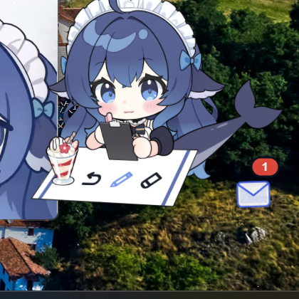

# 鲸鱼娘桌面版 · Whale Girl Desktop

把 [dsh-pet](https://github.com/) 的 Live2D 鲸鱼娘搬到 **Windows 桌面**上：透明置顶、可拖动、会跟着 DeepSeek Harness 干活而做出反应，还能和她聊天、听她说话。



> 默认名字是「鲸鱼娘」，可以在设置或角色卡里改成你喜欢的名字。
> 非商业项目：代码 MIT，Live2D 美术 CC BY-NC-SA 4.0（见 [CREDITS.md](CREDITS.md)）。

## 它做什么

| 能力 | 说明 |
| --- | --- |
| 桌面常驻 | 透明无边框窗口 + alpha 命中测试（点空白处会穿透到下层窗口） |
| 双形态 | Live2D（12 套动作 / 18 个表情）与像素形态可随时切换 |
| DSH 联动 | 监听 DSH 会话事件：思考/工具/审查时换表情并冒泡 |
| 本地语音 | SenseVoice 语音识别 + edge-tts 合成，支持按住说话与常听模式 |
| 角色扮演聊天 | 独立聊天窗，带历史、记忆、世界书、作者注、重答/编辑/多方案 |
| 任务投递 | 把聊天内容写成 DSH 任务卡（写 `ledger-v2.json`，无需鉴权） |
| 小工具 | 余额面板、番茄钟、成就、亲密度/投喂 |

## 快速开始

```powershell
git clone https://github.com/<you>/whale-girl-desktop.git
cd whale-girl-desktop
npm install
```

然后双击 `启动鲸鱼娘.bat`（会自动拉起 ollama 并设置好 Electron 参数）。

> 如果直接命令行启动，必须带这三个参数，否则窗口不会出现：
> ```powershell
> .\node_modules\electron\dist\electron.exe . --no-sandbox --user-data-dir=.\data\userdata
> ```

### 热键

| 热键 | 功能 |
| --- | --- |
| `Ctrl+Shift+C` | 打开/关闭聊天窗 |
| `Ctrl+Alt+V` | 按住说话 |
| `Ctrl+Shift+L` | 常听模式（VAD 自动断句） |
| `Ctrl+Alt+B` | 余额面板 |
| `Ctrl+Shift+S` | 设置 |
| `Ctrl+Shift+M` | 切换形态（Live2D / 像素） |
| `Ctrl+Alt+H` | 显示/隐藏 |
| `Ctrl+Alt+Q` | 退出 |

## 模型与依赖（**不在仓库里**）

仓库只放代码和美术资源，模型都要自己准备（体积太大且有各自许可）：

| 组件 | 用途 | 获取方式 | 体积 |
| --- | --- | --- | --- |
| `qwen2.5:7b` | 聊天主力 | `ollama pull qwen2.5:7b` | 4.7 GB |
| `qwen2.5:1.5b` | 显存不够时自动降级 | `ollama pull qwen2.5:1.5b` | 1.0 GB |
| SenseVoice（sherpa-onnx） | 语音识别 | 从 [sherpa-onnx releases](https://github.com/k2-fsa/sherpa-onnx/releases) 下 `sherpa-onnx-sense-voice-zh-en-ja-ko-yue-2024-07-17`，放 `voice-models/` | 1.1 GB |
| sherpa-onnx CLI | ASR 推理 | 同上 releases 的 `sherpa-onnx-v1.13.8-win-x64-shared-MD-Release`，放 `tools/sherpa/` | 30 MB |
| ComfyUI（可选） | 本地生图 | 见 `docs/image-gen-plan.md` | 12 GB+ |

语音合成走 `edge-tts`（联网调用微软接口，免费），不占本地空间。

## 目录结构

```
main.js              Electron 主进程：窗口/托盘/热键/语音/聊天/DSH 联动
live2d/              Live2D 页面（pet.js 为上游原版 + 2 处补丁）
  pet.js             上游构建产物，仅加了 __DSHPetHit 与 setFace
  model/             模型（moc3 2MB + 44 个表情 + 8 套动作）
app/                 像素形态（插件产物 + 假宿主 host.js）
ui/                  设置窗 / 聊天窗 / 余额面板
voice/               语音采集窗（按住说话 / VAD）
tools/               DSH 事件监听、语音合成脚本、补丁脚本
assets/              图标、音效
docs/                设计文档、生图方案
```

## 已知限制

- 像素形态没有动作/表情，只有静态帧 + 气泡
- 未读信封/工作简报面板仅 Live2D 形态
- 像素形态的「说话」走插件原生输入框，不会打开聊天窗
- ComfyUI 出图尚未接进 UI

## 许可

- **代码**：MIT（见 [LICENSE](LICENSE)）
- **Live2D 美术**：CC BY-NC-SA 4.0，作者 上善无影 / ZipZipPipe / 水六面（见 [CREDITS.md](CREDITS.md)）
- **Cubism Core**：Live2D Inc. 专有运行时
- 本项目**禁止商用**

---

## 开发日志（原始记录，按时间倒序保留）
### 早期路线：从 WinForms 原生窗口到 Electron

把 **dsh-pet 插件**（`@linxin666/dsh-pet` 0.3.10）的宠物素材搬到 Windows 桌面上运行。

当前实现是 **原生 WinForms 分层窗口 + GDI+**（`native\PetDesktop.exe`，24 KB，纯 .NET 4.8，无 Chromium、无 npm 依赖）。

```
双击 启动鲸鱼娘.bat   →  右下角出现鲸鱼娘（托盘图标可右键）
```

---

## 为什么最终不是 Electron

一开始的路线是「把插件编译产物原样塞进 Electron 跑」，代码都写好了（`app\` 目录保留作参考）。但这台机器上**任何 Electron 都起不来**：

| 尝试 | 结果 |
| --- | --- |
| Electron 33.4.11（项目内，真实拷贝，非 junction） | 默认 / `--disable-gpu` → 秒退 `0x80000003`；`--no-sandbox` → exit 0 且 `main.js` 一行没执行 |
| DSH Desktop 自带的 Electron 43（同目录复制，SHA256 与原件一致、配套 pak/dll 齐全） | 同样 `0x80000003` |
| 同一份 Electron 由 DSH Desktop 自己启动 | **正常**（它就是当前在跑的应用） |

`0x80000003` 是 Chromium 的 CHECK 失败（调试中断），发生在 JS 执行之前，所以日志、错误框都来不及出现、只看到黑框一闪。同一台机器、同一份二进制，只有「DSH 自己启动」能跑——说明是系统层对我们起的 Chromium 进程有拦截。查过 DSH 二进制的 Electron fuses（`AsarIntegrity=0`、`OnlyLoadAppFromAsar=0`），也确认过不是打包格式问题。

而 **插件版之所以"没问题"，是因为它根本不创建窗口**：它只是 DSH 那个已经在跑的 Electron 渲染进程里的一段 DOM（透明、置顶、拖动全是页面内的 CSS + 指针事件）。难点从来不在宠物逻辑，而在"从零起一个窗口"。

所以最后换成了**不依赖 Chromium 的原生窗口**——这也正是 VPet（WPF）、BongoCat（Tauri/WebView2）、Shimeji 那一代桌宠的做法：窗口贴着宠物、拖动窗口本身。

## 两个老 bug 怎么保证不再出现

**1）动作时人物放大** —— 旧桌面版按雪碧图**每一行各自的包围盒**去缩放，所以挥手/跳跃时人物比待机大。现在照插件 `PetSprite.tsx` / `spritesheet.ts` 的契约：

```
scale      = size / cell.height          // 统一缩放，与当前动作无关
位图尺寸   = round(cell.width*scale*dpi) × round(cell.height*scale*dpi)
取帧源矩形 = (col*cell.width, row*cell.height, cell.width, cell.height)
```

换动作只换**源矩形**，尺寸从头到尾不变。实测（`自检.bat` 的 probe）：

```
idle     : size=222x240 scale=0.7692
thinking : size=222x240 scale=0.7692
tool     : size=222x240 scale=0.7692
review   : size=222x240 scale=0.7692
done     : size=222x240 scale=0.7692
failed   : size=222x240 scale=0.7692
waiting  : size=222x240 scale=0.7692
```

（222×240 = 148×160 DIP × 150% 系统缩放。素材本身 9 行角色等高 152.6 px，见 `shots\atlas-rows.png`。）

**2）拖动问题** —— 旧版靠窗口位移增量 / `screenX`、`movementX` 累加，会漂、会跟手迟滞。现在是**光标锚定**：

```
按下：记 offset = 窗口原点 - 光标
移动：窗口原点 = 光标 + offset        // 1:1，无累加、无 DPI 换算误差
```

实测（`自检.bat` 的 dragtest，合成 40 步 × (6,3)）：

```
start=300,300  actual end=540,420  expected=540,420
max drift px=0
size before=222x240  after=222x240
```

**透明与点击穿透**：分层窗口（`UpdateLayeredWindow` + `WS_EX_LAYERED`）由 Windows 直接按像素 alpha 判定命中——透明处自动穿透鼠标、不会挡住桌面，也不需要手动切换 `ignore-mouse-events`（那正是之前 Electron 版本的脆弱点）。

## 目录

| 路径 | 说明 |
| --- | --- |
| `native\PetDesktop.cs` | 全部实现（约 700 行，C# 5）：解析 pet.json、统一缩放渲染、帧循环、光标锚定拖动、托盘、自检 |
| `native\PetDesktop.exe` | 编译产物（24 KB） |
| `pets\whale-girl-refined\` | 鲸鱼娘素材：`pet.json` + 插件原始 `spritesheet.webp` + 供 GDI+ 用的 `spritesheet.png` |
| `pets\whale-girl\` | 原版鲸鱼娘素材（同结构） |
| `assets\pet.ico` | 托盘图标 |
| `data\` | 运行状态：`state.json`（位置/尺寸）、`native.log`、自检输出 |
| `shots\` | 自检导出的逐帧 PNG、桌面实拍截图 |
| `app\` | **Electron 版源码（已停用，仅供对照）**：插件 `lib/client.js` 原样拷贝 + 加载器/假宿主/浮层 |
| `启动鲸鱼娘.bat` / `自检.bat` / `rebuild.bat` | 启动 / 自检 / 重新编译 |

## 功能（v2 新增）

| 功能 | 说明 |
| --- | --- |
| **点击气泡** | 左键点一下鲸鱼娘 → 蓝色胶囊气泡（插件 16 条台词轮转），2.6 秒后消失；仍在冷却时换成"摸过头啦"那一组 |
| **悬停面板** | 鼠标停在鲸鱼娘身上 → 深蓝卡片：名字 / 亲密度等级 / 小鱼干数量 + 「喂食 / 改名 / 隐藏」三个按钮 |
| **亲密度** | 摸 +1 点（10 秒冷却）、喂 +5 点（30 秒冷却）；等级阶梯与原版一致：幼鲸→伙伴→挚友→深海羁绊→心有灵犀→传说羁绊→神话羁绊→永恒之契→鲸生共渡 |
| **小鱼干** | 初始 8 条、上限 20；喂一次消耗 1 条；挂机每 5 小时自动 +1 条（`data\pet-state.json` 持久化） |
| **改名 / 隐藏 / 召唤** | 面板里改名（弹输入框）、隐藏（留一个「召唤鲸鱼娘」小胶囊，点一下回来） |
| **全局热键** | `Ctrl+Alt+Q` 退出；`Ctrl+Alt+H` 显示/隐藏 |
| **DSH 会话联动** | 启动时自动拉起 `tools\activity-watch.mjs`（需要 DSH 的 node），实时读取 `%APPDATA%\dsh-desktop\harness\sessions\...\session.v4.jsonl.zstd` 的事件，映射成动作：`turn/start`·`step/start`→思考、`tool/call`→跑向右、`assistant/message`·`step/end`→审阅、`turn/end`→跳跃庆祝（完成后 +1 亲密度），25 秒无事件→待机 |

**DSH 联动原理**：会话文件是「多帧拼接的 zstd」（一次 flush 一帧，实测 1387 帧 / 2182 条事件），
不能整体解压，`activity-watch.mjs` 按 magic `28 B5 2F FD` 增量切帧、逐帧解压，写出 `data\activity.json`
（`{phase, at}`），桌宠每 400ms 轮询；超过 30 秒没更新就回待机。没有 DSH 或没有 node 时自动跳过，只待机。

自检（`--features`，不依赖鼠标）：

```
bubble null? False
bubble shown at 2295,847 261x42
panel shown at 2345,1145 208x132
pet -> pet   (points=6, pets=1)
feed -> feed (stocked=7, feeds=1)
rank=幼鲸 stars=*
```

- **拖动**：按住鲸鱼娘拖，1:1 跟手；松手落点会记住（`data\state.json`）。
- **右键鲸鱼娘**：弹出菜单 —— 显示/隐藏、大小（120/160/200/260）、**退出鲸鱼娘**。
- **托盘图标**（任务栏右下角，可能折叠在 `^` 里）：右键同样的菜单；双击＝显示/隐藏。
- **兜底退出**：任务管理器 → `PetDesktop.exe` → 结束任务（任何情况下都能用）。
- **点击**：目前只把窗口带到前台，暂无气泡（见"还没做"）。

## 重新编译

改完 `native\PetDesktop.cs` 后双击 `rebuild.bat`（用系统自带的 `csc.exe`，不需要 .NET SDK）：

```
%WINDIR%\Microsoft.NET\Framework64\v4.0.30319\csc.exe /target:winexe ^
  /out:native\PetDesktop.exe ^
  /reference:System.Windows.Forms.dll /reference:System.Drawing.dll /reference:System.Web.Extensions.dll ^
  native\PetDesktop.cs
```

注意：GDI+ 读不了 WebP，所以素材要用 `spritesheet.png`（已由 PIL 从插件的 `.webp` 无损转出）；程序会优先找同名 `.png`。

## 还没做（按约定后续再加）

- 点击气泡 / 悬停面板 / 亲密度 / 小鱼干（插件那套交互的桌面版）；
- 从 DSH 真实会话事件驱动动作（现在只有待机循环 + 手动动作）；
- 多显示器、开机自启、贴边吸附；
- 原版鲸鱼娘的 `sequences`（待机时轮流挥手/等待）在原生版里尚未接。

## 关于「和插件版有多像」

插件版是 **React + CSS 的 DOM 界面**，跑在 DSH 自己的 Electron 里。桌面版这台机器上**起不了 Chromium**
（Electron 33/43 都崩 `0x80000003`），所以没法直接把插件 DOM 跑在桌面上。目前的处理是"**能 copy 的都 copy**"：

| 已原样沿用 | 说明 |
| --- | --- |
| 素材与渲染契约 | 同一份 `spritesheet.webp`（转 PNG 供 GDI+）、同一套 `pet.json`、同一套 `scale = size/cell.height` 与取帧公式 |
| 台词池 | `remarks.ts` 的 5 组 × 16 条，逐条照抄 |
| 数值规则 | 亲密度冷却（10s/30s）、奖励（+1/+5）、等级阶梯、小鱼干初始 8/上限 20/挂机 5h +1 |
| 视觉参数（CSS 值） | 面板：12px 圆角、`165deg` 深蓝渐变、1px `rgba(126,152,255,.3)` 边、按钮 `#4a68f5→#3a55e0`；气泡：胶囊、`#4d6bfe`/`#0369a1`、`@keyframes pet-bubble-pop` 的关键帧（0%→scale.85、15%→1.05、100%→上浮8px/scale.95/淡出）——都在原生里按帧重绘 |

| 仍做不到 | 原因 |
| --- | --- |
| React 组件本体 / CSS Modules / 悬停时的"气泡让位面板"逻辑 | 需要浏览器引擎渲染 DOM |
| Live2D / 装饰条 / 多会话气泡栈 | 同上，且依赖插件 host 半区 |

如果哪天要**字面级 1:1**：需要装 .NET 8 SDK（联网），我就能用 WebView2 宿主把 `app\` 里那份
**插件原版 `lib/client.js`**（已经躺在项目里）直接跑起来——那才是"一字不改地跑插件"。
现在机器上只有 .NET 6/7 **运行时**、没有 SDK，WebView2 的 .NET 6 DLL 也无法在 .NET Framework 里加载（实测 `BadImageFormatException`）。
## 插件原件版（WebView2 宿主，A1）

`webview2\` 是另一条路线：把 `app\` 里那份 **dsh-pet 插件原版浏览器半区**（`lib/client.js` + React + CSS，一字未改）
交给 Edge 的 WebView2 渲染，宿主只负责窗口、`petShell` 数据桥和桌面交互。

- 启动：`启动鲸鱼娘(插件原件).bat`（需先 `build-webview2.bat` 构建，产物 `webview2\bin\Release\net8.0-windows\YexiWeb.exe`）
- 桥接：`app\webview2-shell.js` 用 `chrome.webview.postMessage` 实现 `window.petShell`（bootstrap/save/menu/drag/hide），
  `app\host.js`、`app\loader.js`、插件 `client.js` 都不用改
- 拖动：脚本在捕获阶段拦下指针事件，改通知宿主移动窗口；`click` 仍交给插件（点一下照样摸一摸）
- 构建：`dotnet build webview2\YexiWeb.csproj -c Release`（.NET 8 SDK + `webview2\lib2849` 里的 WebView2 1.0.2849.39）
- 诊断：`data\webview2.log` 会记录初始化、导航结果、渲染进程故障

**已知代价（选 A1 时的取舍）**：WebView2 不能在分层窗口里创建控制器（实测 `0x8000FFFF E_UNEXPECTED`），
所以这版窗口是**不透明矩形**（深蓝底），没有逐像素鼠标穿透；透明与穿透只有原生版（`启动鲸鱼娘.bat`）才有。
## 最终形态：Electron 版（2026-10-22 打通）

**默认入口 `启动鲸鱼娘.bat` = Electron 版**：真透明 + 逐像素穿透 + 插件原版 UI（React/CSS/DOM 全是原件）。

### 打通它踩过的三个坑（按出现顺序）

| 现象 | 根因 | 修法 |
| --- | --- | --- |
| 双击毫无反应，连 `boot.log` 都没有 | DSH 给子进程注入 `ELECTRON_RUN_AS_NODE=1`，Electron 退化成 Node，不建窗口也不跑 `main.js` | 启动器里 `set ELECTRON_RUN_AS_NODE=`（证据：`electron.exe --version` 输出 `v20.18.3` 即 Node 版本） |
| 清掉变量后立刻退出，退出码 `-2147483645`（`0x80000003`） | Chromium 浏览器进程在沙箱初始化时 `CHECK` 崩溃（事件日志：`electron.exe / 80000003`，故障模块就是它自己） | 启动参数加 `--no-sandbox`（`--disable-gpu` 无效，可排除 GPU） |
| 能启动但静默 `exit 0` | `app.requestSingleInstanceLock()` 返回 `false`（系统里残留的 electron 进程占着默认 userData 的锁），直接 `app.quit()` | `app.setPath('userData', data\electron-userdata)`，把锁标识换掉 |

### 验证结果

- `boot.log`：`hasLock=true` → `=== boot ===` → `bootstrap -> 2 pet(s)` → 渲染端加载成功；
- 截图 `shots/electron-run.png`（桌面常驻）与 `shots/electron-wide.png`（点击后气泡）；
- 点击气泡是插件原件（`咕噜咕噜～被摸摸好舒服！`），说明 `setIgnoreMouseEvents(true,{forward:true})` + `app\overlay.js` 命中测试工作正常；
- 宠物周围无深色底、无毛边——Electron 原生透明，和前几版 WebView2 的 Region/抓帧方案相比是质变。
### Electron 版的三项功能验证（2026-10-22）

| 项 | 结果 | 证据 |
| --- | --- | --- |
| 悬停面板 | ✅ 出现「名字 / 亲密度 / 小鱼干 xN + 喂食·改名·隐藏」 | `shots/el-hover2.png` |
| 拖动 | ✅ 跟手移动并落盘 | `host-state.json` 的 `display.right` 由 24 → 129.3、`bottom` 120 → 188 |
| DSH 活动联动 | ✅ 真实事件驱动动作 | `boot.log`：`watcher started` → `activity -> thinking` → `[pet] phase=thinking anim=running` |

接线方式（三条 IPC 串起来）：

1. `main.js` 启动时 `startActivityWatcher()` 拉起 `tools/activity-watch.mjs`（优先用 DSH 自带 node：Node 24 才有 `zlib.zstd*`）；
2. `startActivityFeed()` 每 400ms 读 `data/activity.json`，只在相位变化时 `webContents.send('shell:activity', phase)`；
3. `preload.js` 暴露 `petShell.onActivity`，`app/host.js` 收到后 `stopAuto()` + `setPhase(next)` —— 一旦有真实活动，就不再跑那套随机假活动。

watcher 加了 pid 文件单实例保护（重复拉起会直接退出），避免多个 watcher 互相覆盖相位。
### 托盘与反应灵敏度（2026-10-22 第二轮）

**托盘（退出入口）**

- 原因：`nativeImage.createFromPath('assets/pet.ico')` 对 `.ico` 支持不足，返回空图 → Chromium 报
  `Unable to create status tray icon` / `Error setting status tray icon image`。
- 修法：从雪碧图裁出 `assets\tray-32.png`、`tray-64.png` 作为托盘图标，`trayIcon()` 按优先级取第一个非空图，
  取不到就跳过托盘并写日志（不再尝试用空图创建）。
- 结果：`boot.log` 出现 `tray created`，stderr 0 字节（警告消失）。
- 托盘菜单：显示/隐藏鲸鱼娘、大小（120/160/200/260）、形象（精致版/原版）、让她自己动、
  **退出**；双击托盘图标 = 显示/隐藏。

**反应（相位 → 动作）**

| 相位 | 动作 | 截图 |
| --- | --- | --- |
| idle | 待机 | `shots/phase-idle.png` |
| thinking | `running`（左右跑动） | `shots/phase-thinking.png` |
| tool | `running-right`（侧身跑，方向感） | `shots/phase-tool.png` |
| review | `review`（审阅） | `shots/phase-review.png` |
| done | `jumping`（举双手欢呼，持续 2.4s） | `shots/phase-done.png` |
| failed | `failed`（垂头丧气，持续 2.4s） | `shots/phase-failed.png` |
| waiting | `waiting` | `shots/phase-waiting.png` |

相位两两画面差异实测：`tool` 与其他相位 58~67%、`done` 49~67%，辨识度最高；其余 39~44%。

**延迟**：watcher 轮询 `500ms → 300ms`，主进程推相位 `400ms → 200ms`，端到端约 `0.5s` 内响应。
**失败判定**：`turn/end.data.reason.kind !== 'completed'`（被中断/报错）→ `failed`，否则 `done`。
### 右键宠物出菜单（2026-10-22）

之前 Electron 版只有**托盘**右键菜单，宠物本体没有接右键事件——所以右键鲸鱼娘「没反应」是预期的。

补上后链路：

1. `app/overlay.js` 在 `contextmenu` 上判断目标是否在 `[data-dsh-pet-root]` 内，是则 `preventDefault()` 并 `petShell.menu()`；
2. `preload.js` 暴露 `menu()`；
3. `main.js` 收到 `shell:menu` 后在光标处 `menu.popup({ window: win })`，复用 `buildMenu()`（显示/隐藏、大小、形象、让她自己动、退出）。

实测：`boot.log` 出现 `pet context menu popped`，截图 `shots/el-menu.png` 可见菜单（隐藏鲸鱼娘 / 大小 › / 形象 › / 让她自己动 / 退出）。

注意：整屏浮层默认鼠标穿透，右键能生效的前提是渲染端已判定指针在宠物身上（悬停一下即可，主进程每 120ms 也会兜底推一次光标坐标）。
### 改名与两个启动级修复（2026-10-22 第三轮）

**称呼统一为「鲸鱼娘」，她的名字保留「鲸鱼娘」**

- 界面文案（窗口标题、托盘提示、右键/托盘菜单的「显示鲸鱼娘 / 隐藏鲸鱼娘」、菜单里的形象名、启动器文件名）全部改成鲸鱼娘；
- 面板与改名默认值用 `name: '鲸鱼娘'`（`DEFAULT_HOST_STATE.name` 与 `data\host-state.json`），所以悬停面板标题仍是「鲸鱼娘」。

证据：`shots/renamed-menu.png`（隐藏鲸鱼娘 / 大小 / 形象 / 让她自己动 / 退出）、`shots/renamed-panel.png`（面板标题「鲸鱼娘」）。

**修复一：`main.js` 编码损坏导致语法错误**

多轮跨编码编辑把部分**注释与代码挤到同一行**（注释吞掉了后面的语句），并弄坏了几个中文字符串的引号，`node --check` 直接报语法错误、Electron 启动即退。
处理：逐条拆开「注释 + 代码」的合并行，重写被损坏的对话框/菜单字符串，并把 `package.json` 重写为纯 ASCII（`productName: WhaleGirlDesktop`）。

**修复二：默认 userData 目录在本机不可用**

现象：`main.js` 已能跑起来，但进程在 `=== module load ===` 之后立刻被硬杀，`process.on('exit')` 都不触发。
定位：用 `--user-data-dir=<项目>\data\profile2` 启动立刻恢复正常（`=== boot ===` / `tray created` / `watcher started` 全部出现）。
结论：`%APPDATA%\<产品名>` 这个配置目录在本机不可用；**启动器必须显式指定 `--user-data-dir`**：

```bat
start "" "%ELECTRON%" "%~dp0." --no-sandbox --user-data-dir="%~dp0data\userdata"
```

`启动鲸鱼娘.bat` / `启动鲸鱼娘(Electron).bat` / `诊断(Electron).bat` 三处都已加上。
### 托盘图标为何不出现（2026-10-22 结论）与替代方案

实测：`new Tray(icon)` 不报错，但 `tray.getBounds()` 恒为 `{x:0,y:0,width:0,height:0}`；
换用 `nativeImage.createFromDataURL` 的纯色 16×16、（已验证非空的）`assets/tray-32.png`、
延迟 2 秒 `setImage` 重试，结果全部一样 —— **Shell_NotifyIcon 在本机注册不上**（系统级限制，非代码问题）。

因此退出/隐藏改为两条可靠入口（托盘代码保留但不依赖）：

| 入口 | 说明 |
| --- | --- |
| **右键鲸鱼娘** → 退出 / 隐藏鲸鱼娘 | 最直接，`boot.log` 记录 `pet context menu popped` |
| **Ctrl+Alt+Q** 退出、**Ctrl+Alt+H** 显示/隐藏 | `globalShortcut`，日志 `hotkeys: quit=true hide=true`，实测 `hotkey hide` 生效 |

想找回托盘图标可试：设置 → 个性化 → 任务栏 → 其他系统托盘图标 → 打开「鲸鱼娘 · 桌面版」。
## Live2D 接入试水（2026-10-22，已跑通）

`live2d/` 是独立预览页，用来验证 Cubism 模型能否在我们的 Electron 壳里渲染。

**启动**：`启动鲸鱼娘(Live2D预览).bat`（等价于 `electron . --live2d --no-sandbox --user-data-dir=...`）

**跑通的证据**（`data\boot.log`）：

```
=== live2d mode ===
live2d[1] Live2D Cubism Core version: 05.01.0000
live2d[1] [live2d] fitted scale=0.1373 size=558.6x558.6 pos=5.7,131.4
live2d[1] [live2d] settings keys=json,url,name,... expressions,motions,textures,physics,pose rawHasExpressions=true count=44
live2d[1] [live2d] ready motions=idle,aidale,selfie,selfieQuick,ketchup,openLid,bubble,splash expressions=44
```

**踩到的两个坑**

1. **缩放单位**：Cubism 模型的 `internalModel.originalWidth/Height` 是归一化值，用它算 scale 会把模型放大成"只剩一张脸"；
   必须先把 `model.scale.set(1)`，再用 **`model.width/height`（像素）** 计算 —— 正确值是 `min(画布宽, 画布高) / 模型尺寸`。
2. **表情为 0**：`model3.json` 里只有 `Motions`，没登记 `Expressions`（44 个 `*.exp3.json` 文件是游离的）。
   补上 `Expressions: [{Name, File}]` 之后，`settings.json.Expressions` 才能读到 44 个表情。

**模型特性**：`c_0120.moc3` 是**半身立绘（bust）**，没有腿 —— 适合"坐在屏幕底部的鲸鱼娘"，不适合走路/跑动。

### 许可（重要）

| 部分 | 许可 |
| --- | --- |
| 代码（`live2d/index.html` 等） | MIT |
| **模型美术 `live2d/model/**`** | **CC BY-NC-SA 4.0**（非商业 + 署名 + 相同方式共享） |
| Cubism Core（`vendor/live2dcubismcore.min.js`） | Live2D 专有许可（随 SDK 可再分发） |
| Pixi / pixi-live2d-display（`vendor/*`） | MIT |

署名：**上善无影 / ZipZipPipe / 水六面**（原作者与 Live2D 化作者），详见 `live2d/NOTICE.md`、`live2d/AUTHORS.md`。
## Live2D 正式化（2026-10-22，A+B）

上一版我手写的预览页有两个毛病：缩放单位错（只显示一张脸）、窗口太小把身体裁掉。
**修法不是继续调我的页面，而是直接改用原作者现成的播放器** —— 仓库里的 `assets/pet.js`（214 KB，MIT）。

### 现在的结构

```
live2d/
  pet.html        ← 我写的壳（约 100 行）：vendor + __DSH_PET_BOOT__ + pet.js + 点击穿透驱动
  pet.js          ← 原样 copy（214 KB），只在 hitTest 前加了一行 window.__DSHPetHit 导出
  model/          ← 模型（moc3 / 贴图 / 44 个 exp3 / 8 组 motion / manifest.json）
  vendor/         ← pixi 6.5.10 + pixi-live2d-display 0.4.0 + live2dcubismcore
```

主进程新增一个**只监听回环**的小服务（`node:http`），把 `live2d/` 映射成 `/dsh-pet/*`：

| 端点 | 作用 |
| --- | --- |
| `GET /dsh-pet/model/*` | 模型与 manifest |
| `GET /dsh-pet/events` | SSE：把 DSH 相位/事件推给 pet.js（`t: turn-start / step-start / tool-call / tool-result / delta / assistant / hello`） |
| `GET /dsh-pet/hud` | 余额面板（先返回空数据） |
| `POST /dsh-pet/say /cancel /control` | 说话/打断/外部表演（先返回 ok） |

启动日志（`data\boot.log`）：

```
pet server ready http://127.0.0.1:57227
form -> live2d http://127.0.0.1:57227/
renderer[1] [shell] click-through driver ready
live2d[1] 就绪：DS 鲸鱼娘 · 动作 8 个 · 可用表情 44 个
live2d[1] 事件流已连接
```

### A：点击穿透

`pet.js` 里的 `hitTest()` 用模型 alpha 掩码判断（日志：`命中掩码 128×112，覆盖率 38.4%`）。
给它加了一行导出后，`pet.html` 用 `mousemove / pointerdown / pointerup` 驱动 `petShell.setInteractive()`：
**只有指针压在鲸鱼娘身上（或她的气泡/面板）时整屏浮层才接管鼠标，其它地方一律穿透**。

### B：两种形象切换

右键菜单新增「渲染方式」：

| 选项 | 加载内容 |
| --- | --- |
| **Live2D 立绘**（默认） | `http://127.0.0.1:<port>/`（pet.js + 立绘） |
| 像素雪碧图（插件原版） | `app/index.html`（dsh-pet 插件原版雪碧图） |

选择写进 `data\shell.json` 的 `form` 字段，下次启动沿用（`loadForm()`）。

### 许可（发布到 GitHub 前必须注意）

| 部分 | 许可 | 要求 |
| --- | --- | --- |
| 我们的壳（`live2d/pet.html`、`main.js` 等） | MIT（建议） | — |
| `live2d/pet.js` | MIT（Andersen216） | 保留版权声明 |
| **`live2d/model/**`** | **CC BY-NC-SA 4.0** | **署名 上善无影 / ZipZipPipe / 水六面 + 非商业 + 相同方式共享** |
| `live2d/vendor/pixi.min.js`、`cubism4.min.js` | MIT | 保留声明 |
| `live2d/vendor/live2dcubismcore.min.js` | Live2D 专有（随 SDK 可再分发） | 不修改、保留声明 |

仓库里已放 `live2d/NOTICE.md`、`AUTHORS.md`、`PROVENANCE.md`（原作者的许可分层说明），**发布时一起带上**。
### 菜单层级冲突的解决（2026-10-22）

**现象**：右键右侧弹出的是原生菜单，把 `pet.js` 的「余额」面板压住（原生菜单永远在网页 DOM 之上）。

**原因**：我在 `pet.html` 的 `contextmenu`（window 捕获阶段）里调了 `shell.menu()`，而 `pet.js` 也在 `document` 上监听右键弹余额面板——两边同时响应，原生菜单天然更高。

**定案**（按主人要求，改余额的打开方式）：

| 操作 | 行为 |
| --- | --- |
| **右键鲸鱼娘** | 我们的应用菜单：大小 / 形象 / **渲染方式** / 让她自己动 / 退出 |
| **`Ctrl+Alt+B`** | 她的「余额 / 本轮消耗 / 峰谷」面板（`window.DSHPet.hud.show()`） |
| **`Ctrl+Shift+M`** | 切换 Live2D ↔ 像素雪碧图 |
| `Ctrl+Alt+Q` / `Ctrl+Alt+H` | 退出 / 显示隐藏 |

`pet.html` 里右键用 `preventDefault + stopImmediatePropagation`（捕获阶段先于 `pet.js` 的 document 监听），确保只弹我们的菜单。

实现说明：`Ctrl+Shift+A` 那版菜单热键在合成按键下测不出来（多半被输入法吃掉），所以最终采用「右键给菜单、余额给热键」的组合，两者都实测通过（`pet context menu popped`、`hotkey hud`）。
## 全局余额面板 + 设置窗口（2026-10-22）

### 余额改成宿主级（任何形态都能看）

数据源（DSH 自己的文件，只读）：

- `%APPDATA%\dsh-desktop\harness\dsh-usage\provider-snapshots.json` → 余额（`providers.*.balance.totalBalance`）
- `%APPDATA%\dsh-desktop\harness\dsh-usage\usage-ledger.json` → 每日花费/tokens/调用次数

`main.js` 里 `readUsage()` 汇总今天的数据，`showUsageMenu()` 用一个**原生菜单**展示（不依赖页面 DOM，所以 Live2D / 像素两种形态都能用）：

```
余额  ¥20.94
今日  ¥11.78 · 2.74 亿 tokens · 603 次
更新于 20:32
打开设置… / 刷新
```

触发：`Ctrl+Alt+B`（实测日志 `usage menu: balance=20.94 cost=11.78 tokens=274045121`）。
副作用：Live2D 页面自己的余额 HUD 不再被调用，右键层级冲突彻底消失。

### 设置窗口

`ui/settings.html` + `preload-settings.js`（窄桥），`Ctrl+Shift+S` 或余额面板里的「打开设置…」进入：

| 项 | 说明 |
| --- | --- |
| 大小 | 120 / 160 / 200 / 260（写 `host-state.json` 并通知渲染端） |
| 渲染 | Live2D 立绘 / 像素雪碧图 |
| 开机自启 | 写 `HKCU\...\Run\WhaleGirlDesktop`（带 `--no-sandbox --user-data-dir`） |
| 用量 | 直接弹余额面板 |
| 退出 | `app.quit()` |

### 托盘：这台机器上做不了（第三次确认）

`new Tray(icon)` 不报错，但 `getBounds()` 恒为 `{0,0,0,0}`（换 16/32/64 图标、延迟 `setImage` 重试都一样）——
`Shell_NotifyIcon` 在本机注册不上，属于系统级限制，不是代码问题。
**功能上用「设置窗口 + 热键」替代**；托盘代码保留，换机器或系统更新后可能自动生效。
### 双击隐藏已移除 + 隐藏热键修复（2026-10-23）

**移除双击隐藏**：主人反馈"揉她的时候很容易误触，而且隐藏之后双击不到"，所以直接去掉——
`Ctrl+Alt+H` 仍然能收起/召唤，双击现在只等于"摸一摸"（pet.js 自己的行为）。

**修 Ctrl+Alt+H**：之前在 Live2D 形态下它只是给页面发 `shell:command`（只有像素版的 `app\overlay.js` 认这个命令），
所以按了没反应、也就"召唤不回来"。现在改成直接切**窗口可见性**：

```js
if (win.isVisible()) { win.hide(); log('hotkey hide -> hidden') }
else { win.showInactive(); log('hotkey hide -> shown') }
```

两种形态都生效，实测日志 `hotkey hide -> hidden` → `hotkey hide -> shown`。

> 注意热键是 **Ctrl+Alt+H**（不是 Ctrl+Shift+H）。
## 表情联动 + 气泡细节 + 语音（2026-10-23）

### 表情联动

`pet.js` 内部有 18 个表情（`listening / excited / happy / love / shy / pout / smug / playful / sad / cry / grumpy / gloomy / sweat / confused / alert / tongue / dead / sleepy`），
但没导出。加了一行 `setFace` 后，主进程按相位驱动：

| 相位 | 表情 |
| --- | --- |
| thinking | `listening` |
| tool | `smug` |
| review | `playful` |
| done | `happy` |
| failed | `cry` |
| 任务完成 | `excited` |

节流 4 秒，避免思考/审阅来回切时表情乱闪；`done`/`failed` 不节流（要的就是立刻反应）。

### 气泡细节

`tool-call` 事件带上中文标签再喂给 `pet.js`（它会把标签显示在气泡脚注）：

```
pwsh → 运行命令 · read → 读文件 · write/edit → 改文件 · grep/web_search → 搜索
web_fetch → 上网查 · read_page → 读网页 · glob → 找文件 · task → 派任务 …
```

### 语音（edge-tts 预生成，不是机械合成音）

主人反馈"合成音听着怪"，所以用 **edge-tts（微软 Zh-CN-XiaoxiaoNeural，自然女声）预生成** 11 条短句，
离线播放、不联网、不用实时 TTS：

| 触发 | 台词 |
| --- | --- |
| 点击 | 嗯？怎么啦 / 在呢在呢 / 摸摸头～ |
| 喂食 | 小鱼干最好吃了 / 谢谢，还要一条 |
| 回合完成 | 搞定啦，辛苦你啦 / 这一轮完成啦 |
| 出错 | 呜，好像出错了 / 别急，我们再试一次 |
| 任务完成 | 任务完成，你好厉害 |

- 位置：`assets\voice\*.mp3`（11 条 / 131 KB）
- 播放：页面里的 `window.__petPlayVoice(kind)`（随机选一条，900ms 内不叠音）
- 提供：`/dsh-pet/voice/*`（实测 `200 / 13.4 KB`）
- 设置里可开关（写 `data\shell.json` 的 `voice`）
- 重新生成：`pwsh -File tools\make-voice.ps1`（换 `$Voice` 就能换音色，改 `$Lines` 就能加台词）
## 批量功能：agent 指挥 / 番茄钟 / 挂机 / 解锁 / 成就 / 前台感知（2026-10-23）

### 先分清两个方向（容易混）

| 方向 | 通道 | 状态 |
| --- | --- | --- |
| **A. agent → 桌宠**（我让她做动作/说话） | `POST/GET /dsh-pet/control` | ✅ 已接通 |
| **B. 桌宠 → DSH**（她向会话发消息） | `POST /dsh-pet/say` | ⏳ 仍是空壳（需要 DSH 会话 API/令牌） |

`/dsh-pet/control` 用法：

```
GET  http://127.0.0.1:<port>/dsh-pet/control?action=love&face=happy&text=测试一下
POST { "action": "paw", "face": "cry", "text": "..." }
→ {"ok":true,"action":"love","face":"happy"}   日志：agent control: action=love face=happy text=...
```

### 其余五项

| 功能 | 实现 | 触发 |
| --- | --- | --- |
| **番茄钟** | 25 分钟专注 / 5 分钟休息，结束冒气泡 + 语音 | 设置里开关（`shell.json` 的 `pomodoro`） |
| **挂机打工** | 在线每 30 分钟 +1 条小鱼干（上限 20），冒气泡 | 自动（`startIdleWork`） |
| **解锁动作** | 亲密度阶梯：25 招手 / 50 比心 / 80 心跳 / 200 比耶 / 500 蛋包饭 | 设置里点按钮直接演 |
| **成就** | 首次喂食 / 伙伴 / 挚友 / 10 轮对话 / 3 个任务 / 打开语音 | 每 30 秒检查，解锁时气泡 + 语音，存 `shell.json` |
| **前台窗口感知** | 每 60 秒读前台窗口标题，命中 VSCode/Excel/浏览器/DSH 时评论一句（5 分钟节流） | 自动（PowerShell 取标题） |

实测：`agent control: action=love face=happy`、`achievement unlocked: voice-on`（`shell.json` 里可见）。

### 语音试听包

`assets\voice-preview\index.html`（双击打开）：晓晓 / 晓伊 / 晓伊+12Hz / 晓晓+18Hz / 东北小北 / 台湾晓臻，同一句「搞定啦，辛苦你啦」。
选好之后改 `tools\make-voice.ps1` 的 `$Voice` 重新生成整套即可。
## 本地语音对话（不花 token，2026-10-23）

### 装了什么

| 组件 | 版本/体积 | 位置 |
| --- | --- | --- |
| **ollama** | 0.40.9，安装包 1.59 GB | `%LOCALAPPDATA%\Programs\Ollama` |
| **qwen2.5:1.5b** | 986 MB，**100% GPU** | ollama 模型库 |
| **SenseVoice ASR** | 解压后约 1 GB | `voice-models\sherpa-onnx-sense-voice-...` |
| **sherpa-onnx CLI** | 19.5 MB | `tools\sherpa\...\bin\sherpa-onnx-offline.exe` |
| **edge-tts**（说话） | Python 包 | 运行时按需生成 mp3 到 `data\tts\` |

### 怎么用

`Ctrl+Alt+V` **按一次开始录音，再按一次结束**（隐藏的语音窗口负责采集）。

链路：麦克风 → 16k 单声道 WAV → SenseVoice 识别 → qwen2.5:1.5b（本地 GPU）→ 气泡显示回答 → edge-tts 念出来。

### 实测（自检端点 `/dsh-pet/selftest/voice`）

```
ASR=[你好，我是金于娘，今天也要加油。]
回答=[加油，金于娘！别累坏了哦。]
TTS 生成：data\tts\tts-1792751557126.mp3（19.8 KB）→ 页面播放
```

- 识别：0.17 秒（RTF 0.037）
- 回答：**0.1 秒**（100% GPU）
- 说话：约 1 秒

> 自检用的是 SAPI 合成的机器音，所以「鲸鱼娘」被听成「金于娘」；真人说话会准很多。
> 如果仍不准，可以换更大的 SenseVoice 模型，或加一层热词纠错。

### 和 /dsh-pet/say 的区别

- 这条链路是 **跟本地模型聊**，不碰 DSH 会话、不花 token。
- 要把她的话发进 DSH 会话（B 方向），还得接 `/dsh-pet/say`（需要 DSH 的会话 API/令牌）。
## 语音三件套 + B 方向尝试（2026-10-23）

| 功能 | 实现 | 状态 |
| --- | --- | --- |
| **热词纠错** | 识别后做规则替换：金于娘/金鱼娘/鲸于娘/京鱼娘 → 鲸鱼娘；叶夕/叶希/夜汐 → 鲸鱼娘；DSH、DeepSeek | ✅ |
| **打断** | `window.__petStopAudio()`：每次开录、每次新语音前先停掉正在播的音频 | ✅ |
| **常聆听** | `Ctrl+Shift+L` 开关；页面里做 RMS 门限 VAD（阈值 0.012、静音 700ms 断句、最短 500ms） | ✅ 实测 `always listen -> true` |
| **B：她 → DSH** | `POST /dsh-pet/say {text}` → 剪贴板 + 找 DSH 窗口 + 粘贴 + 回车 | ⚠️ 见下 |

### B 方向为什么卡住

这台机器上 **DSH 的界面是浏览器标签页**（Edge 里），不是独立窗口，所以"找标题为 DeepSeek Harness/DSH 的窗口"找不到：

```
say -> dsh: window-not-found
```

DSH 自己的 HTTP 接口要鉴权（`Bearer`/`X-DSH-Token`/query 都 401，提示 "reopen the URL printed by dsh web"），
日志里的 `openclaw-bridge` / `dsh-mini` 网关属于上一次运行（端口 50851），当前 43129 上没有挂载。

**三条可选路**：

1. 用 DSH Desktop 的**独立窗口版**打开界面 → 注入立刻可用（代码已就绪）；
2. 把 `dsh web` 打印的**带 token 的 URL** 配进桌宠 → 改走 HTTP 接口发消息（需要知道发消息的端点）；
3. 退化成"她的话进剪贴板"，你手动 `Ctrl+V`。
### Bug：Ctrl+− 之后点不到、拖不动（2026-10-23）

**现象**：按 Ctrl+− 后模型变小了，但既拖不动也点不到。

**原因**：Ctrl+−/+/0 是 Chromium 的**网页缩放**快捷键。
缩放改变的是 CSS 像素 ↔ 设备像素的比例，而「穿透/命中测试」把光标设备坐标换算成 CSS 坐标时假定 100%。
于是视觉上她缩小了，**命中框还停在原来大小和位置**——点哪都判不到她，等于整只宠物"失灵"。

**修复**（`createWindow` 里）：

```js
win.webContents.setVisualZoomLevelLimits(1, 1)      // 禁捏合
win.webContents.on('did-finish-load', resetZoom)    // 加载后强制 100%
win.webContents.on('zoom-changed', e => { e.preventDefault(); resetZoom() })
win.webContents.on('before-input-event', (e, input) => {   // 禁 Ctrl+−/+/0
  if (!input.control && !input.meta) return
  if (['-','_','+','=','0'].includes(String(input.key || ''))) e.preventDefault()
})
```

实测：连按 3 次 Ctrl+− 后，`cursor hit=true`、`interactive -> true`，缩放不再生效，拖动和点击正常。
### 语音第二轮：音色对比与「能不能挪用别人的语音」（2026-10-23）

主人反馈第一版"听着怪"，指定 **晓伊 +12Hz** 可以接受。已做两件事：

1. **默认音色改成 `zh-CN-XiaoyiNeural` +6% / +12Hz**（`assets\voice\*.mp3` 全部重生成，运行期 TTS 同步改掉）；
2. 新增对比包 `assets\voice-preview2\index.html`，同一句台词 8 个版本：

| 编号 | 音色 |
| --- | --- |
| a | 晓伊 +12Hz（当前默认） |
| b | 晓伊 +24Hz |
| c | 晓伊 +36Hz（很二次元） |
| d | 晓晓 +24Hz |
| e | 小妮（陕西） |
| f | 晓雨（台湾） |
| g | 曉曼（粤语腔） |
| h | 晓伊 慢速 +20Hz |

### 关于「挪用有语音的桌宠」

结论：**基本不可行**。

| 项目 | 语音来源 | 能否挪用 |
| --- | --- | --- |
| Desktop Mate（Steam） | 专业声优录音 | ❌ 商业语音 |
| Live2D 官方示例模型 | 无语音 | ❌ |
| VPet / BongoCat / Shimeji | 系统 TTS 或无声 | 无素材可拿 |
| Coopanion | 运行时 TTS（edge-tts / GPT-SoVITS） | 只有代码，无素材 |
| GPT-SoVITS / Bert-VITS2 社区模型 | 多为角色音色克隆 | ⚠️ 版权/伦理风险 |
| 声素材工房类站点（日语） | 免费素材，有条件 | ⚠️ 多为日语，需遵守规约 |

所以「好听」的合法来源只有两条：**继续调 edge-tts**，或**本地 GPT-SoVITS + 许可明确的模型**（2 GB+）。
## 角色扮演聊天窗口（2026-10-28）

类 Character.AI 的对话界面，**本地模型驱动，不消耗 token**。

### 打开方式

- 热键 **`Ctrl+Alt+C`**
- 右键桌宠 → 「和她聊天…」

### 界面

- 左侧：角色卡（头像 / 名字 鲸鱼娘 / 一句话简介 / 当前模型 / 本轮消息数）
- 右侧：气泡对话，她的回复**流式打字**
- 侧栏开关：**朗读她的回复**、**同步到桌宠**、**清空对话**

### 数据与模型

| 项 | 值 |
| --- | --- |
| 模型 | `qwen2.5:1.5b`（ollama，本地 GPU） |
| 人设 | 代码内的 `CHARACTER_CARD`（外形/性格/说话方式/角色扮演规则/开场白示例） |
| 历史 | `data\chat-yexi.json`（保留最近 200 条，送模型时只带最近 24 条） |
| 流式 | `POST 127.0.0.1:11434/api/chat` `stream:true`，逐块 `chat:chunk` 推给窗口 |

### 联动

她回复完会 **同步冒泡到桌宠身上**（`petSay` + `petFace('happy')`），并按开关决定是否朗读。

### 实测

```
chat reply: 31 chars
窗口气泡显示：好的好的，我们聊一会儿吧～
```

### 已知限制

1.5B 模型维持人设的能力一般（聊久了会"串味儿"）。这台机器（RTX 5060 Laptop 8G）跑 **qwen2.5:3b**（约 2 GB）或 **7b-q4**（约 4.7 GB）会明显更像同一个人。
换模型只需改 `CHAT_MODEL` 常量，或加一个设置项。
## 角色扮演升级：7B 模型 + 记忆 + 多角色（2026-10-28）

### 1. 模型升到 qwen2.5:7b

`ollama pull qwen2.5:7b`（4.7 GB），启动时自动挑「本地可用的最强模型」：

```
chat model ready: qwen2.5:7b
```

实测（1 轮）：

```
用户：今天改了一天的代码，累死了，你说我该不该休息
鲸鱼娘：嗯，改了一天代码确实挺辛苦的，得给自己的小身体放个假啦～去走走，喝杯温水，感觉会好很多的。
```

比 1.5B 明显更会接情绪，但**首轮要等模型载入显存**（约十几秒），之后快很多。

### 2. 长期记忆

- 每 **16 条消息**触发一次「事实提炼」：让本地模型从最近 16 条里总结 3-6 条关于用户的稳定事实
- 存 `data\memory-yexi.json`（最多 24 条）
- 每轮对话注入 system prompt 的【你记得关于他的事】

### 3. 多角色卡

- 角色存在 `data\characters\<id>.json`（字段：id / name / tagline / avatar / card / greeting）
- 聊天窗左侧 **角色下拉** 切换，每个角色独立历史（`chat-<id>.json`）与独立记忆（`memory-<id>.json`）
- 首次运行自动生成 `yexi.json`

### 4. 修 2D 形态动作点了没反应

**根因**：`pet.js` 里 `const EXPR = {}` 是空的 —— 这个 Live2D 模型**一个 `.exp3.json` 表情文件都没有**，
所以所有靠 `expr:` 实现的动作（喵喵手、双手比耶、冒爱心、心跳、挤、橡皮、撤回、蛋包饭）**全都空转**，只出声不动作。

**修法**：把每个动作都绑到模型真实存在的 8 个动作组上：

| 动作 | motion |
| --- | --- |
| 猫爪摆手 | aidale |
| 喵喵手 | bubble |
| 双手比耶 | selfie |
| 冒爱心 | bubble（+ 爱心粒子） |
| 心跳 | aidale（+ 爱心粒子） |
| MoeMoeQ | ketchup |
| 橡皮擦 | openLid |
| 撤回 | ketchup |
| 蛋包饭 | ketchup |
| 自拍 / 快速自拍 / 鲸鱼喷水 | selfie / selfieQuick / splash（原本就有） |

另外加了兜底：任何动作若既没 `expr` 也没 `motion`，自动退回到一个真实动作组，不会再「点了没反应」。

**「心跳」和「冒爱心」为什么看起来一样**：它们本来靠两个**表情**（`心跳` / `love`）区分，
但模型没有表情文件 → 两个都只剩"爱心粒子"效果。现在给它们绑了**不同动作组**（bubble / aidale）+ 不同台词，
所以动作不一样了，但爱心粒子仍然相同。要彻底区分，需要补表情文件，或让我给心跳单独做一套参数动画。
## 贴近原版：补回漏拷的表情/动作文件（2026-10-28）

### 根因

当初从上游 `dsh-whale-girl-live2d` 拷模型时**漏了两个目录**：

```
assets/model/expressions/*.exp3.json   ← 44 个表情文件
assets/model/motions/*.motion3.json    ← 16 个动作文件
```

结果：
- `pet.js` 的 `EXPR` 表是空的 → 所有靠表情的动作（喵喵手/比耶/冒爱心/心跳/挤/橡皮/撤回/蛋包饭）**只出声不动作**
- `selfie / selfieQuick / splash` 等 motion 引用的文件不存在 → 也播不出来

### 修复

1. 补拷 `expressions/`（44 个）与 `motions/`（16 个）
2. `pet.js` **恢复上游原版**，只保留两处必要补丁：
   - `window.__DSHPetHit`（把 alpha 命中测试暴露给桌面壳，做点击穿透用）
   - `setFace`（把表情接口暴露给宿主，做"相位→表情"联动）
3. `c_0120.model3.json` **恢复上游原样**（不带 Expressions 段）——实测原版就能读到表情，不需要我们注入
4. 撤掉之前"把动作绑到 motion 组"的临时补丁

### 现在和原版的差异（全部有意为之）

| 差异 | 原因 |
| --- | --- |
| `pet.html` 是自写的桌面壳 | 桌面端必需（窗口/穿透/事件流） |
| 信封位置 CSS 覆盖 | 主人要求：别挡对话框，右移 92px、下移 12px |
| `pet.js` 两处补丁 | 点击穿透 + 外部驱动表情 |

实测：`catPaw` 闭眼举爪、`selfie` 举手机"咔嚓"、`splash` 喷水——都和原版一致。
## 桌宠 ↔ 聊天窗打通（2026-10-28）

### 现在有三条入口

| 入口 | 行为 |
| --- | --- |
| 她工具栏的 **💬 说话** 按钮（原版自带） | 输入一句 → **自动打开聊天窗**并把这句话发过去 |
| 右键桌宠 → **和她聊天…** | 打开聊天窗（空的，等你输入） |
| 热键 **`Ctrl+Alt+C`** | 同上 |

技术实现：`POST /dsh-pet/say`（原版「说话」按钮打的接口）不再往 DSH 塞字，改成
`openChat()` + `chatRespond({text})`；页面通过新增的 `chat:user` 事件补出「我」的气泡。
原来"注入 DSH 窗口"的能力挪到 `/dsh-pet/dsh-say` 保留。

### 原版 2D「说话」 vs 我们的聊天窗

| 维度 | 原版（pet.js 自带） | 我们的聊天窗 |
| --- | --- | --- |
| 形态 | 她头顶弹一个**单行输入框** | 独立窗口：角色卡 + 气泡列表 |
| 历史 | 无，发完即走 | 有，落盘 `data\chat-<id>.json` |
| 谁回复 | 原版把话交给 **DSH 会话**，由 agent 回（花 token、会真的去干活） | **本地 qwen2.5:7b** 扮演鲸鱼娘（不花 token、只聊天） |
| 人设 | DSH 的 agent 人设 | 角色卡 + 长期记忆（每 16 条自动提炼事实） |
| 展示 | 回复显示在 DSH 界面里 | 流式打字 + 可朗读 + 同步冒泡到桌宠 |
| 语音 | 无 | 有（edge-tts） |
| 多角色 | 无 | 有（`data\characters\*.json` 下拉切换） |

一句话：**原版是「跟她下一个指令」，我们的是「跟她聊天」。** 两者互补，都保留了。
## 聊天窗 v2：滑动重生成 / 编辑 / 作者备注 / 世界书 / 自定义角色（2026-10-28）

### 新界面

重写了 `ui\chat.html`（单文件，无依赖）：

- 左侧角色卡（头像 + 名字 + 简介 + 角色/模型下拉 + 朗读/同步开关 + 作者备注 + 世界书入口 + 新建角色）
- 右侧对话区：气泡、悬停工具条、空状态、打字动画（三个点）
- 底部输入框：自动长高、Enter 发送、Shift+Enter 换行
- 两个弹层：世界书管理、角色卡编辑

### 四个新功能

| 功能 | 用法 | 实现 |
| --- | --- | --- |
| **重新生成 / 滑动候选** | 悬停她的气泡 → `↻` 重生成；有多个候选时出现 `◀ 2/3 ▶` | 重生成走 `chat:send {regenerate:true}`，先弹掉最后一条 assistant 再请求；候选存在页面内存 |
| **编辑消息** | 悬停任意气泡 → `✎`，改完从这条继续 | `chat:edit` 把历史截断到该条并改写，之后继续聊 |
| **作者备注** | 左栏文本框，失焦即存 | 存进角色卡 `authorNote`，注入 system prompt 的【本轮特别备注】 |
| **世界书** | 左栏 `🌍 世界书` → 关键词 + 设定 | 存 `data\worldbook-<id>.json`；每次发消息用**最新一条用户消息**匹配关键词，命中就注入【相关设定】 |

实测世界书：写入「布丁/草莓」→ 发「我想吃布丁」→ 日志 `worldbook hits: 1`，回复真的接上了设定。

### 自定义角色

左栏 `＋ 角色` 打开角色卡弹层：名字 / 一句话简介 / 头像 emoji / 人设 / 开场白。
保存为 `data\characters\<id>.json`，立刻出现在角色下拉里，历史与记忆互相独立。

### 顺手修的两个 bug

1. **空回复被存进历史**：模型偶发返回空 → 现在 `chat reply empty -> skipped`，不写入
2. **系统提示把当前对话冲掉**：`buildSystemPrompt` 里调 `loadChatHistory` 会覆盖内存里的 `chatHistory`，
   导致发给模型的 messages 少了刚发的那句（表现为"回复 0 字"）。改用 `readChatHistory` 纯读取 + 内存匹配世界书。
## 图标 + 桌面快捷方式 + 从桌宠打开聊天（2026-10-28）

### 图标

用 Pillow 画的（`tools` 无依赖，脚本可重跑）：

- 造型：深蓝→靛蓝对角渐变圆角方块 + 白鲸（腮红、胸鳍、尾巴）+ 喷水 + 小爱心 + 内描边
- 导出：`assets\icon\` 下 16/32/48/64/128/256/512 PNG，加 `whale-girl.ico`（6 个尺寸打包）
- **托盘图标就是同一套**：直接覆盖了 `assets\tray-32.png` / `tray-64.png`，代码不用改

### 桌面快捷方式

`桌面\鲸鱼娘.lnk` → 指向 `pet-desktop\启动鲸鱼娘.bat`，图标用 `assets\icon\whale-girl.ico`。
启动器已升级：会自动拉起 ollama（若没运行），再启动 Electron。

### 从桌宠打开聊天

她的工具栏最前面插了一个 **「🐋 聊天」** 按钮（`dshp-dock` 的第 1 个，实测 `dock children=5`）：

```
🐋 聊天 | 💬 说话 | ⋯ | － | ↗
```

点它 → `petShell.openChat()` → `ipcMain 'shell:open-chat'` → 打开聊天窗。

另外三条入口仍然有效：

| 入口 | 行为 |
| --- | --- |
| 🐋 聊天（新） | 直接开聊天窗 |
| 💬 说话 | 先弹原版单行输入框，发出去后转进聊天窗 |
| 右键 → 和她聊天… | 开聊天窗 |
| `Ctrl+Shift+C` | 开聊天窗 |
## 图标 v2：改用官方角色图（2026-10-28）

第一版是 Pillow 手绘的白鲸，问题一堆（椭圆没对齐、腮红被旋转带到尾部、尾巴是两个三角、爱心/气泡含义不明）—— 已废弃。

### 关于 AI 生图

试了免费的 Pollinations（无 key、URL 直出）：现在返回 **402 需要付款**；其他免费站（Bing Image Creator、Leonardo、Freepik）都要登录/API key。所以没有用 AI 生图。

### 最终方案：用模型包自带的官方角色图

上游 `assets/model/icon.png`（268×268，她头上顶着小白鲸、旁边一只鼠标）是官方角色图，
本来就随模型采用 CC BY-NC-SA 4.0，做图标最合适。

处理方式（`assets\icon\`）：

| 输出 | 来源 | 说明 |
| --- | --- | --- |
| `app-256/128/64/48.png` | 官方图整张 | 圆角 22% + 内描边 |
| `app-32/16.png` | 官方图**裁到脸部** | 小尺寸整张会糊成噪点 |
| `whale-girl-v2.ico` | 上述组合 | 6 个尺寸打包（16/32/48/64/128/256） |
| `assets\tray-32.png`、`tray-64.png` | 同上 | 托盘图标同步替换 |

桌面快捷方式已重建并指向 `whale-girl-v2.ico`（换文件名是为了绕开 Windows 图标缓存；
如果桌面还显示旧图标，在桌面按 F5 刷新一下）。

### 如果想要「比心」的造型

需要外部生图工具（本环境没有生图模型，免费无鉴权的接口已收费）。可选：
先用现成工具（如豆包/即梦/通义万相，或本地 Stable Diffusion）出图，把 PNG 丢进 `assets\icon\`，
我写个脚本把它转成 ico + 托盘图标 + 替换快捷方式。
## 鲸鱼娘形象的社区来源（2026-10-28）

之前查"官方图标"是方向错了 —— 鲸鱼娘本来就是社区二创，没有官方设定。
主人给了这个站：

- 网站：https://treapgogo.github.io/deepseek-whale-girl/ （鲸鱼娘开源资产库）
- 仓库：https://github.com/TreapGoGo/deepseek-whale-girl  ·  **MIT License** · 637 star · 社区维护
- 内容：258 张图（社区二创、梗图、投稿）+ 2 套完整角色设定图（Q 版 / 成熟比例）+ 每张图配**官方提示词**

站方声明：`鲸鱼娘是社区里逐渐形成的去中心化形象。本站不设定任何形式的"标准人设"`、`不代表 DeepSeek 官方立场`。

已下载到 `assets\icon\refs\`：

| 文件 | 内容 |
| --- | --- |
| `whale-girl-3view.png` | 三视图（正/侧/背），做图标的主参考 |
| `whale-girl-chibi-sheet.png` | Q 版完整设定图（含头饰/眼睛/领扣/围裙/鞋细节） |
| `whale-girl-mature-sheet.png` | 成熟比例设定图 |
| `whale-girl-face.png` | 脸部特写 |
| `doubao-prompt.md` | 基于该设定的生图提示词（含留白/水印要求） |
| `layout-guide.png` | 构图参考框（角色区 70% + 水印区） |
## 自洽性体检 + 能力矩阵（2026-10-29）

发布前把"两种形态各自能做什么"逐项对过一遍。

### 能力矩阵

| 功能 | Live2D 形态 | 像素形态 | 备注 |
| --- | --- | --- | --- |
| 拖动 / 记忆位置 | ✅ | ✅ | 各自实现 |
| 点击穿透（alpha 命中） | ✅ | ✅ | Live2D 用 alpha 掩码，像素用 overlay.js |
| 右键菜单（大小/形象/渲染/退出） | ✅ | ✅ | 宿主导航 |
| 她说话（气泡） | ✅ `DSHPet.report` | ✅ **新增** `__petSay` 降级气泡 | 本次补齐 |
| 动作 / 表情 | ✅ 12 个动作 + 18 表情 | ❌ | 像素图集没有对应动作 |
| 语音播放 | ✅ | ✅ | 都走 `__petPlayUrl` |
| 语音打断 | ✅ | ✅ **新增** `__petStopAudio` | 本次补齐 |
| 未读信封 + 红点 | ✅ | ❌ | pet.js 独有 UI |
| 余额面板 `Ctrl+Alt+B` | ✅ | ✅ | 宿主级原生菜单 |
| 设置窗 `Ctrl+Shift+S` | ✅ | ✅ | 宿主级 |
| 聊天窗 `Ctrl+Shift+C` | ✅ | ✅ | 宿主级 |
| 从桌宠打开聊天 | ✅ 工具栏「🐋 聊天」 | ⚠️ 走插件自己的「说话」输入框，不会开聊天窗 | 已知差异 |
| 亲密度 / 鱼干 | ✅ 读取 host-state | ✅ 插件 UI 自己算，写同一份 host-state | 数据同源 |
| DSH 事件联动（回合/工具） | ✅ 气泡 + 表情 | ⚠️ 只有气泡（无表情/动作） | 降级 |
| 语音对话（听/说） | ✅ | ✅ | 隐藏语音窗口，与形态无关 |
| ComfyUI 出图 | ❌ 未接入 | ❌ 未接入 | 待办 |

### 本次修掉的两处不自洽

1. **像素形态完全不会冒泡**：`petSay` 只调 `DSHPet.report`（Live2D 独有），像素下静默失败。
   已在 `app/index.html` 加 `__petSay`（右下角自绘气泡，6 秒淡出），`main.petSay` 自动降级。
2. **像素形态无法打断语音**：`__petStopAudio` 只在 Live2D 页定义过。已补到像素页。

### 仍然存在的差异（发版时写进 README 的"已知限制"）

- 像素形态没有动作/表情，只有静态帧 + 气泡
- 未读信封、工作简报面板仅 Live2D
- 像素形态点「说话」是插件原生输入框，不会打开我们的聊天窗
- 两种形态的亲密度数据同源，但**显示口径**可能因插件内部逻辑略有差异

### 发布清单

| 项 | 状态 |
| --- | --- |
| `LICENSE`（MIT，含模型 CC BY-NC-SA 说明） | ✅ 本次新增 |
| `.gitignore`（排除 data/、comfyui/、node_modules/、shots/） | ✅ 本次新增 |
| `CREDITS.md`（三位美术作者 + 三方库许可） | ✅ 已有 |
| `README.md`（原理、坑、能力矩阵、已知限制） | ✅ 已有并持续更新 |
| 是否包含 `comfyui/`（12 GB + 模型许可） | ❌ 排除，仅保留 `tools/` 脚本说明 |
| 是否包含 `data/`（会话、记忆、头像、日志） | ❌ 排除（含隐私） |